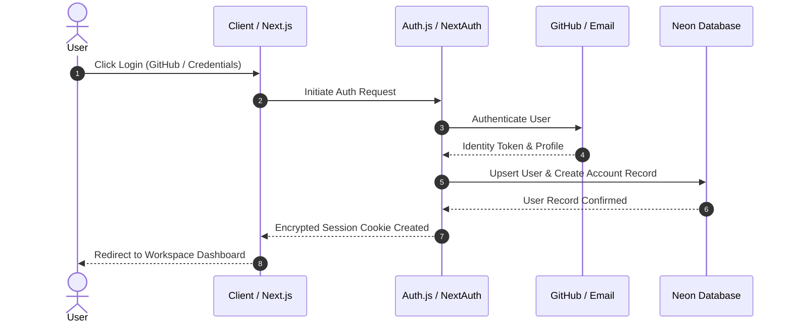
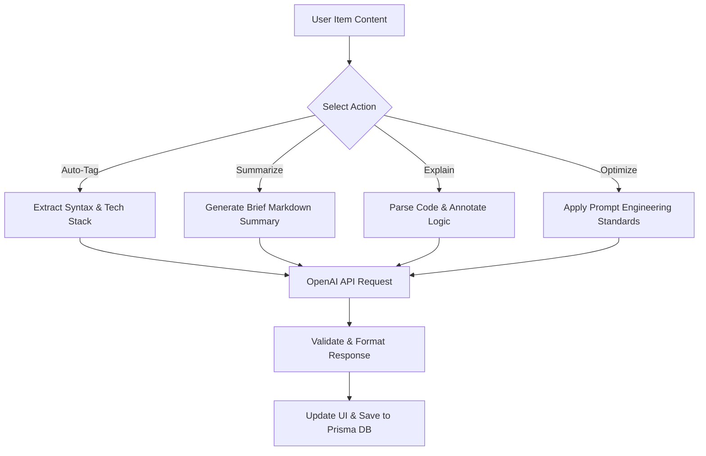
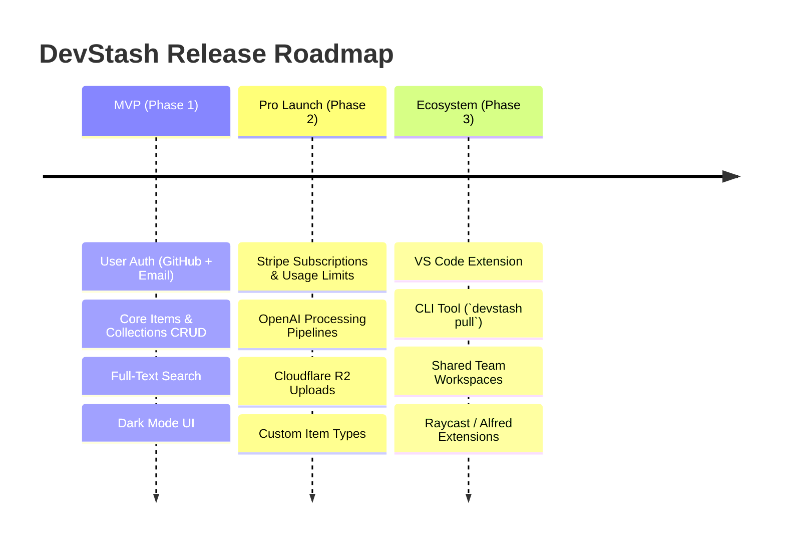

# 🚀 DevStash — Project Overview & Technical Specifications

> **DevStash** is a centralized, AI-enhanced knowledge hub for developers to store, search, organize, and optimize code snippets, AI prompts, terminal commands, context files, and reference material.

---

## 📌 Problem & Solution

### The Problem

Developers frequently context-switch and lose valuable insights because knowledge is scattered across disparate channels:

- **Code snippets:** VS Code scratchpads, Notion pages, or abandoned gists.
- **AI prompts & context:** ChatGPT/Claude history tabs, local `.txt` files.
- **Terminal commands:** Buried deep in shell history (`~/.zsh_history`, `~/.bash_history`).
- **Docs & Links:** Cluttered browser bookmarks and local desktop downloads.
- **Templates:** Scattered across GitHub repositories and local boilerplate folders.

### The Solution

**DevStash** provides **one unified, lightning-fast, AI-powered hub** for all developer knowledge, eliminating friction and keeping developer flow intact.

---

## 🧑‍💻 User Personas

| Persona                        | Primary Needs & Use Cases                                              | Key Features Utilized                               |
| :----------------------------- | :--------------------------------------------------------------------- | :-------------------------------------------------- |
| **Everyday Developer**         | Fast retrieval of boilerplate code, regex snippets, and shell aliases  | Instant search, global keyboard shortcuts, tags     |
| **AI-First Engineer**          | Storing structured prompts, system instructions, and LLM context files | Prompt optimization, AI tags, markdown preview      |
| **Content Creator & Educator** | Reusable code blocks, tutorial notes, and course code snippets         | Organized collections, export options               |
| **Full-Stack Builder**         | API references, environment setups, Docker Compose files, DB schemas   | File attachments, syntax highlighting, custom types |

---

## ✨ Core Features & Functionality

### 1. Unified Item System

DevStash stores multi-modal developer resources into structured items:

- 🔤 **Snippet:** Multi-language syntax highlighted code snippets.
- 🤖 **Prompt:** AI system prompts, chain-of-thought templates, and variable placeholders.
- 📝 **Note:** Rich markdown developer documentation and architectural decision records (ADRs).
- ⚡ **Command:** Shell/CLI scripts (Bash, Zsh, PowerShell, Docker, Git).
- 📁 **File:** Project context files (`.env.example`, JSON schemas, templates).
- 🖼️ **Image:** UI mockups, architecture diagrams, screenshots.
- 🔗 **URL:** Curated documentation links, GitHub repos, and API specs.

_(Note: **Pro plan users** can create Custom Item Types with custom fields and metadata tags.)_

### 2. Multi-Dimensional Organization

- **Collections:** Flexible folders that can contain mixed item types (e.g., a "Next.js + Stripe Stack" collection holding snippets, commands, docs, and prompts).
- **Tagging System:** Hierarchical & auto-generated AI tags for quick cross-collection filtering.
- **Quick Access:** Pin frequently used items to top, or filter by recent activity.

### 3. High-Performance Search

- Full-text fuzzy search powered by database indexing.
- Search across content body, syntax tags, titles, item types, and AI-generated summaries.

### 4. 🧠 AI Superpowers

- 🏷️ **Auto-Tagging:** Automatically extracts tech stacks, languages, and frameworks.
- 📝 **AI Summarization:** Generates TL;DR descriptions for complex code snippets and long documentation notes.
- 💡 **Code Explainer:** Explains obscure regex, bash one-liners, or complex functions.
- 🪄 **Prompt Optimizer:** Refines raw LLM prompts using structured prompt engineering patterns.

---

## 🎨 UI & Design References

Refer to the screenshots in `context/screenshots/` as the visual base for the dashboard UI (does not have to be exact; use as reference):

- [Dashboard Main View 1](screenshots/dashboard-ui-main_1.png)
- [Dashboard Main View 2](screenshots/dashboard-ui-main_2.png)
- [Dashboard Drawer (Part 1)](screenshots/dashboard-ui-drawer_part_1.png)
- [Dashboard Drawer (Part 2)](screenshots/dashboard-ui-drawer_part_2.png)
- [Split View](screenshots/dashboard-ui-main_items_split_View.png)
- [Minimized Collections](screenshots/dashboard-ui-main_collection%20minimize.png)

---

## 🧱 Technology Stack

| Layer              | Technology                                                                        | Description                                      | Docs / Reference                              |
| :----------------- | :-------------------------------------------------------------------------------- | :----------------------------------------------- | :-------------------------------------------- |
| **Framework**      | [Next.js 15+](https://nextjs.org/)                                                | React 19 App Router, Server Actions              | [Docs](https://nextjs.org/docs)               |
| **Language**       | [TypeScript](https://www.typescriptlang.org/)                                     | End-to-end type safety                           | [Docs](https://www.typescriptlang.org/docs/)  |
| **Database**       | [Neon PostgreSQL](https://neon.tech/)                                             | Serverless Postgres                              | [Docs](https://neon.tech/docs)                |
| **ORM**            | [Prisma ORM](https://www.prisma.io/)                                              | Schema definition, migrations, and typed queries | [Docs](https://www.prisma.io/docs)            |
| **Storage**        | [Cloudflare R2](https://www.cloudflare.com/developer-platform/r2/)                | S3-compatible zero-egress file storage           | [Docs](https://developers.cloudflare.com/r2/) |
| **UI & Styling**   | [Tailwind CSS v4](https://tailwindcss.com/) + [shadcn/ui](https://ui.shadcn.com/) | Radix UI primitives & utility-first styling      | [shadcn/ui](https://ui.shadcn.com/)           |
| **Authentication** | [Auth.js (NextAuth v5)](https://authjs.dev/)                                      | GitHub OAuth & Email Credentials                 | [Docs](https://authjs.dev/)                   |
| **AI Integration** | [OpenAI API](https://platform.openai.com/)                                        | Structured AI completion endpoints               | [Docs](https://platform.openai.com/docs/)     |
| **Billing**        | [Stripe](https://stripe.com/)                                                     | Subscriptions, checkout, and webhook sync        | [Docs](https://stripe.com/docs)               |
| **Deployment**     | [Vercel](https://vercel.com/)                                                     | Edge hosting & continuous integration            | [Docs](https://vercel.com/docs)               |

---

## 🗄️ Database Schema (`prisma/schema.prisma`)

```prisma
generator client {
  provider = "prisma-client-js"
}

datasource db {
  provider = "postgresql"
  url      = env("DATABASE_URL")
}

enum Role {
  USER
  ADMIN
}

enum ContentType {
  TEXT
  FILE
  LINK
}

model User {
  id                   String       @id @default(cuid())
  name                 String?
  email                String       @unique
  emailVerified        DateTime?
  image                String?
  password             String?      // Nullable for OAuth users
  role                 Role         @default(USER)
  isPro                Boolean      @default(false)
  stripeCustomerId     String?      @unique
  stripeSubscriptionId String?      @unique
  stripePriceId        String?
  stripeCurrentPeriodEnd DateTime?

  items                Item[]
  customTypes          ItemType[]
  collections          Collection[]
  tags                 Tag[]
  accounts             Account[]
  sessions             Session[]

  createdAt            DateTime     @default(now())
  updatedAt            DateTime     @updatedAt

  @@map("users")
}

model Account {
  id                String  @id @default(cuid())
  userId            String
  type              String
  provider          String
  providerAccountId String
  refresh_token     String? @db.Text
  access_token      String? @db.Text
  expires_at        Int?
  token_type        String?
  scope             String?
  id_token          String? @db.Text
  session_state     String?

  user User @relation(fields: [userId], references: [id], onDelete: Cascade)

  @@unique([provider, providerAccountId])
  @@map("accounts")
}

model Session {
  id           String   @id @default(cuid())
  sessionToken String   @unique
  userId       String
  expires      DateTime
  user         User     @relation(fields: [userId], references: [id], onDelete: Cascade)

  @@map("sessions")
}

model Item {
  id           String      @id @default(cuid())
  title        String
  contentType  ContentType @default(TEXT)
  content      String?     @db.Text
  fileUrl      String?
  fileName     String?
  fileSize     Int?
  mimeType     String?
  url          String?
  description  String?     @db.Text
  language     String?     // e.g. typescript, python, bash, markdown
  isFavorite   Boolean     @default(false)
  isPinned     Boolean     @default(false)

  userId       String
  user         User        @relation(fields: [userId], references: [id], onDelete: Cascade)

  typeId       String
  type         ItemType    @relation(fields: [typeId], references: [id])

  collectionId String?
  collection   Collection? @relation(fields: [collectionId], references: [id], onDelete: SetNull)

  tags         ItemTag[]

  createdAt    DateTime    @default(now())
  updatedAt    DateTime    @updatedAt

  @@index([userId])
  @@index([collectionId])
  @@index([typeId])
  @@map("items")
}

model ItemType {
  id       String   @id @default(cuid())
  name     String
  slug     String
  icon     String?  // Lucide icon name string
  color    String?  // Hex code or Tailwind color string
  isSystem Boolean  @default(false)

  userId   String?
  user     User?    @relation(fields: [userId], references: [id], onDelete: Cascade)

  items    Item[]

  @@unique([slug, userId])
  @@map("item_types")
}

model Collection {
  id          String   @id @default(cuid())
  name        String
  description String?
  icon        String?
  isFavorite  Boolean  @default(false)

  userId      String
  user        User     @relation(fields: [userId], references: [id], onDelete: Cascade)

  items       Item[]

  createdAt   DateTime @default(now())
  updatedAt   DateTime @updatedAt

  @@index([userId])
  @@map("collections")
}

model Tag {
  id     String    @id @default(cuid())
  name   String
  userId String
  user   User      @relation(fields: [userId], references: [id], onDelete: Cascade)

  items  ItemTag[]

  @@unique([name, userId])
  @@index([userId])
  @@map("tags")
}

model ItemTag {
  itemId String
  tagId  String

  item   Item @relation(fields: [itemId], references: [id], onDelete: Cascade)
  tag    Tag  @relation(fields: [tagId], references: [id], onDelete: Cascade)

  @@id([itemId, tagId])
  @@map("item_tags")
}
```

---

## 📐 System Architecture Diagrams

### 1. High-Level Architecture

```mermaid
graph TD
  subgraph Client Tier
    UI[Next.js App Router / React 19]
    SW[Service Worker / Cache]
  end

  subgraph Application Tier (Vercel)
    API[Next.js API Routes & Server Actions]
    AUTH[Auth.js Handler]
  end

  subgraph Data & Storage Tier
    DB[(Neon PostgreSQL Serverless)]
    R2[(Cloudflare R2 Object Storage)]
    REDIS[(Redis Cache / Upstash)]
  end

  subgraph External APIs
    AI[OpenAI Platform]
    STRIPE[Stripe Billing & Webhooks]
  end

  UI <--> API
  API <--> AUTH
  API <--> DB
  API <--> R2
  API <--> REDIS
  API <--> AI
  API <--> STRIPE
```

### 2. Authentication & Authorization Flow



### 3. AI Enhancement Pipeline



---

## 💰 Monetization & Tiering

| Feature / Limit      | Free Plan ($0/mo)      | Pro Plan ($8/mo or $72/yr)           |
| :------------------- | :--------------------- | :----------------------------------- |
| **Item Storage**     | Up to 50 Items         | Unlimited Items                      |
| **Collections**      | Max 3 Collections      | Unlimited Collections                |
| **File Upload Size** | 2 MB per file          | 50 MB per file                       |
| **AI Features**      | ❌ None                | ✅ Auto-Tag, Summaries, Explanations |
| **Custom Types**     | ❌ Built-in types only | ✅ Custom fields & type builder      |
| **Export Options**   | JSON export            | JSON, Markdown Bundle, ZIP archive   |
| **Support**          | Community Support      | Priority Email Support               |

---

## 🗺️ Product Roadmap



---

🏗️ **DevStash — Store Smarter. Build Faster.**
